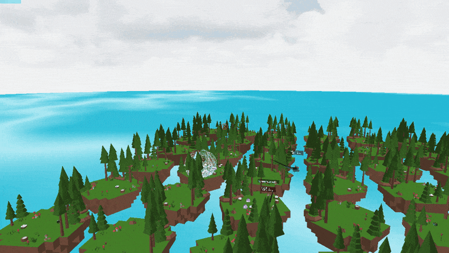
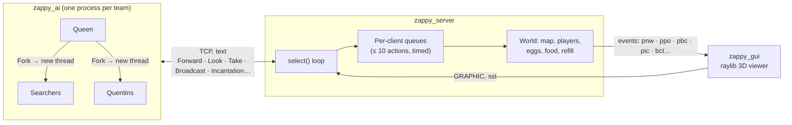

<div align="center">

# Zappy: a networked multiplayer game played by AIs

**A C game server, autonomous C++ AI clients that cooperate through broadcasts, and a 3D raylib viewer to watch the teams race to the top level.**




[Quick start](#quick-start) · [How it works](#how-it-works) · [Protocol](#protocol) · [Team](#team)

</div>

---

## About

Zappy is the end-of-year project of Epitech's second year, built by a team of six. The world is a small planet: a map whose edges wrap around, scattered with food and six kinds of stones. Players belong to teams, must keep eating to survive, and level up by performing **incantations**: rituals that need enough teammates of the same level on one tile, plus a precise set of stones. The first team to get **six players to level 8** wins.

Nobody plays by hand. The project has three programs that only talk to each other over TCP:

- **`zappy_server`** (C) owns the world and the clock, and runs every player's actions in game time.
- **`zappy_ai`** (C++) is a client that plays for one team on its own: it spawns teammates, splits them into roles, gathers stones and organises incantations.
- **`zappy_gui`** (C++, raylib) connects as a spectator and renders the game in 3D: one floating island per tile, animated dinosaurs for the players, and their broadcasts shown as speech bubbles.

## Highlights

- **Single-threaded server on `select()`**: one loop accepts connections, reads every client, and runs whatever actions are due, so no locks are needed anywhere in the game state.
- **Actions run in game time, not on arrival**: each request goes into its client's queue (at most 10 pending) with a cost in time units (`Forward` 7, `Fork` 42, `Incantation` 300…) scaled by the `-f` frequency. A request only blocks the player that sent it, never the others.
- **Directional sound on a wrapping map**: `Broadcast` doesn't tell the receiver where the sender is. It tells them which of the 8 neighbouring tiles the sound comes from, using the shortest path across the map edges and the receiver's facing direction. The AIs use it to find each other.
- **A team AI with roles**: one `zappy_ai` process starts a **Queen**. She first uses up the team's starting slots with throw-away connections, so that every later player hatches from an egg she laid on her own tile. Each newcomer picks a role from what it sees there: **Searchers** explore, pick up stones by priority and follow the Queen's broadcasts back to her; **Quentins** drop their food on the Queen's tile to keep her fed. Each new player is a `std::thread` in the same process with its own socket.
- **3D viewer from a config file**: items, islands and eggs are loaded from glTF models listed in [`modelConfig.cfg`](gui/src/display/modelConfig.cfg), the sea is a wave shader adapted from a raylib example, players are animated models, and you can click a player to see their level and inventory.
- **Unit tests**: Criterion tests cover the server's argument parsing, most AI commands and the GUI events, plus the AI's resource tracking, and run in CI on Epitech's test image.

## Quick start

### Prerequisites

| Dependency | Debian / Ubuntu |
|------------|-----------------|
| C and C++ compilers, Make | `build-essential` |
| Asio (standalone, header-only) | `libasio-dev` |
| raylib 5.0 | build from source, see below |
| Criterion (tests only) | `libcriterion-dev` |

raylib 5.0 isn't packaged everywhere, so build it once:

```bash
sudo apt install cmake libx11-dev libxrandr-dev libxinerama-dev libxcursor-dev libxi-dev libgl1-mesa-dev
git clone --depth 1 --branch 5.0 https://github.com/raysan5/raylib.git
cmake -S raylib -B raylib/build -DBUILD_EXAMPLES=OFF -DCMAKE_BUILD_TYPE=Release
cmake --build raylib/build -j && sudo cmake --install raylib/build && sudo ldconfig
```

### Build and run

```bash
git clone https://github.com/yanishk/zappy.git
cd zappy
make            # builds ./zappy_server, ./zappy_ai and ./zappy_gui
```

Then, in three terminals, from the repository root (the viewer loads its assets from `./gui/assets`):

```bash
./zappy_server -p 4242 -x 6 -y 6 -n red blue -c 6 -f 50
./zappy_gui -p 4242 -h 127.0.0.1 -a
./zappy_ai -p 4242 -n red -h 127.0.0.1     # one per team; start another with -n blue
```

| Server flag | Meaning |
|-------------|---------|
| `-p port` | Port to listen on |
| `-x width`, `-y height` | Map size |
| `-n team1 team2 …` | Team names |
| `-c clientsNb` | Players allowed per team at the start |
| `-f freq` | Time units per second (default 100). Higher is faster |
| `--immortal true` | Players don't need food (for debugging) |

`make tests_run` builds and runs the server and AI test suites.

### Viewer controls

| Input | Action |
|-------|--------|
| Mouse | Look around |
| W A S D | Fly forward, left, back, right |
| Space / Left Shift | Up / down |
| Left Ctrl | Fly faster |
| Left click on a player | Show their level and inventory |
| Right click | Hide it |
| ↑ / ↓ | Speed the game up or slow it down (`sst` sent to the server) |
| F3 | Camera position and map statistics |

## How it works



Each client sends one command per line. The server queues it for that player, works out when it will be done from its cost and the current frequency, and only then replies (`ok`, `ko`, the inventory, what the player sees…). Meanwhile, every change to the world is pushed to the viewer as a short event (`ppo` for a player's new position, `pbc` for a broadcast, `pic` when an incantation starts). The viewer never asks the AIs anything: it rebuilds the whole game from these events.

```
server/      C server: select loop, argument parsing, AI and GUI commands, game rules, Criterion tests
ai/          C++ AI client: network layer, AI roles (Queen, Searcher, Quentin), tests
gui/         C++ raylib viewer: network client, 3D scene, assets (models, GLSL water shader)
doc/         Demo GIF
```

## Protocol

The full protocol lives next to each program:

| Topic | Where |
|-------|-------|
| Server flags, AI commands with their costs, GUI events | [`server/README.md`](server/README.md) |
| Viewer flags and the events it handles | [`gui/README.md`](gui/README.md) |

## Team

Built in four weeks (May to June 2024) by six Epitech students:

| | Part | Main areas |
|---|---|---|
| [**Yanis Harkouk**](https://github.com/yanishk) | Server | Argument parsing, team slots and player connection, map and player initialisation, per-client command queues and timing, input buffering and signal handling, movement, `Eject`, `Fork`, incantations and elevation, food consumption, immortal mode, part of the GUI protocol (`msz`, `bct`, `mct`, `tna`, `plv`, `ppo`, `pin`, `pfk`, `smg`), memory cleanup, server docs, tests for arguments, the lib and GUI commands |
| [**Eva Legrand**](https://github.com/Chaegnal) | Server | `select()` loop and client connections, command dispatch tables, `Broadcast` and sound direction, `Look`, `Take`, `Set`, `Inventory`, `Connect_nbr`, resource spawning and map refill, incantation checks, win condition, most GUI events (`pnw`, `pdi`, `pgt`, `pdr`, `enw`, `ebo`, `edi`, `pex`, `pbc`, `pic`, `pie`, `sgt`, `sst`, `seg`), tests for AI commands, the lib and GUI commands |
| [**Paul Bardeur**](https://github.com/paulbardeur) | AI | AI interfaces, team and role selection, the Queen (incantations, forks, broadcasts), the Quentin, Searchers' return to the Queen and broadcast handling, threads, CI and tests |
| [**Edward Lalande**](https://github.com/edward-lalande) | AI | Repository setup, network layer, AI command layer and broadcast reception, the Searcher (exploration, resource priorities, movement), resource tracking, first thread-per-player version |
| [**Mathis Brehm**](https://github.com/mathisbdkr) | Viewer | Viewer core: game loop and camera, wiring the network client to the scene and applying server events, players and their animations, items, islands, sky, model config parsing, water shader integration, player info panel |
| [**Timothée Plisson**](https://github.com/timotheeplisson) | Viewer | Network client and server-event parsing, eggs, object factory and rendering interfaces, `Sky` / `Sea` classes, speed controls (`sst`), `-a` animation flag |

## Credits

The 3D models come from Sketchfab, mostly under CC BY 4.0, and the islands are built from Kenney's Nature Kit (CC0). Authors and licences are listed in [`CREDITS.md`](CREDITS.md).

## License

Educational project (Epitech, 2024). Third-party 3D models keep their own licences, see [`CREDITS.md`](CREDITS.md).
